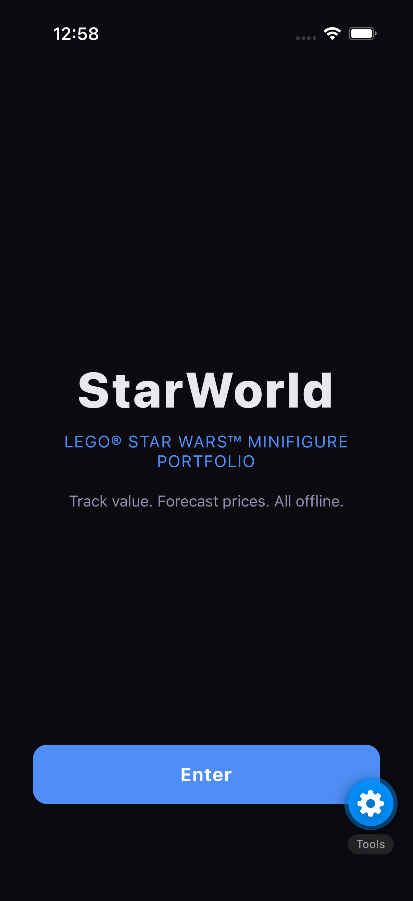
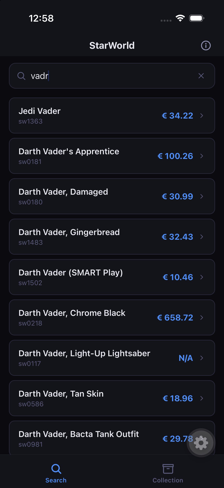
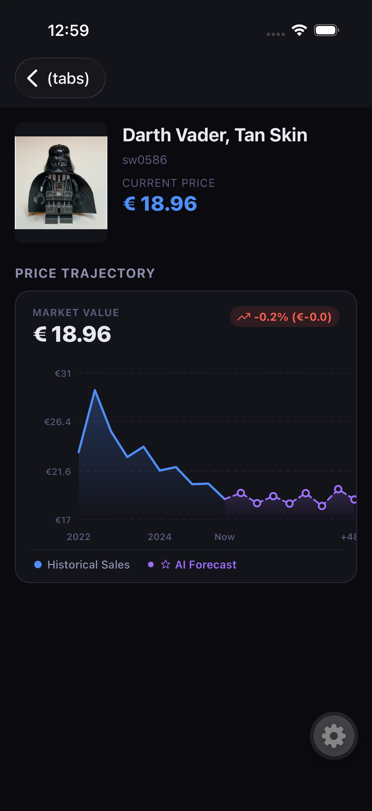
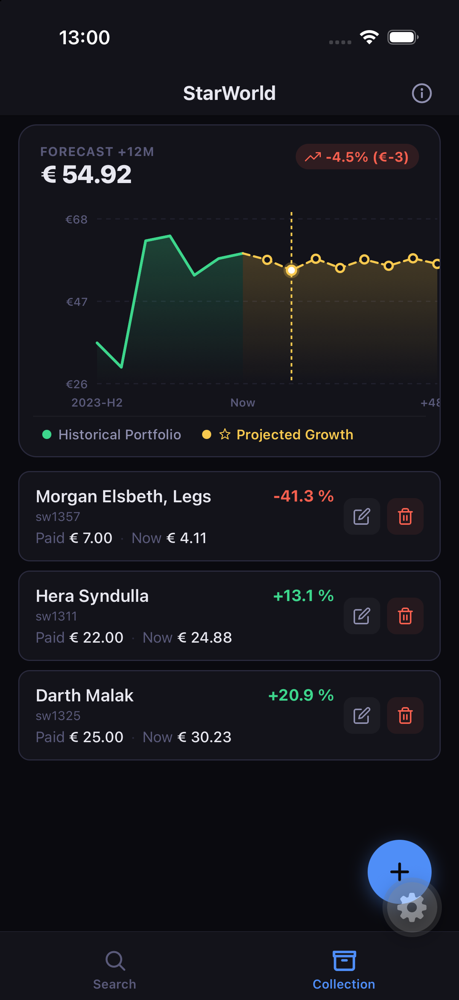
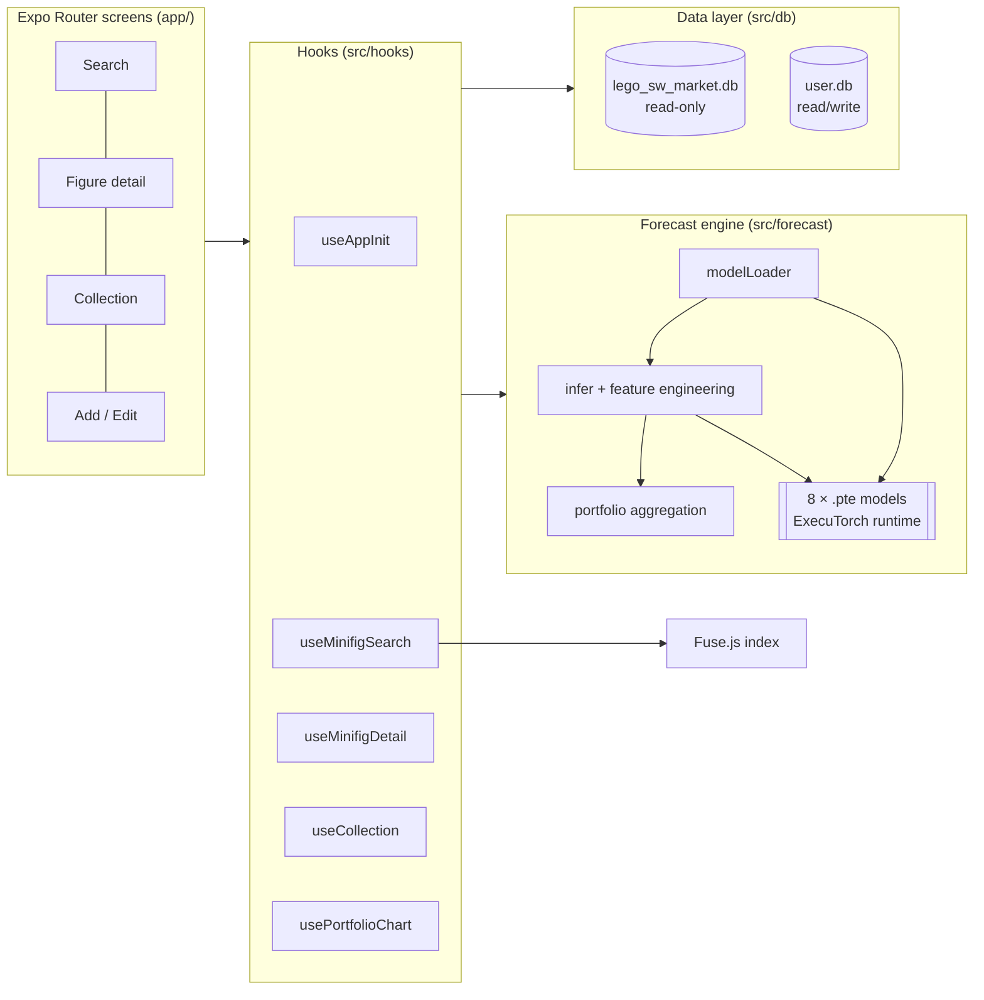
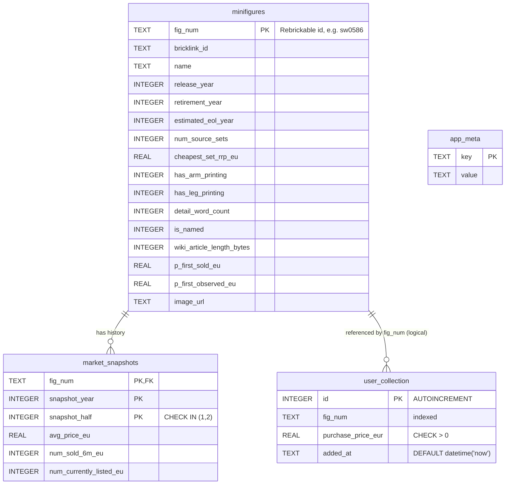

<div align="center">

# StarWorld

**LEGO® Star Wars™ minifigure portfolio tracker with on-device ML price forecasting — fully offline.**

[](https://expo.dev)
[](https://reactnative.dev)
[](https://www.typescriptlang.org)
[](https://github.com/software-mansion/react-native-executorch)
[](https://docs.expo.dev/versions/latest/sdk/sqlite/)
[](LICENSE)

</div>

---

## Overview

StarWorld lets collectors search a catalogue of **1 343 LEGO Star Wars minifigures**, browse **~11 900 half-yearly market price snapshots** (2022 H1 → 2026 H2), record what they paid, and see **AI-generated price forecasts up to 48 months ahead** for both single figures and their whole portfolio.

Everything runs **on the device**: the catalogue is a bundled SQLite database, the search is an in-memory fuzzy index, and the forecasts come from **8 neural/regression models compiled to ExecuTorch `.pte` programs** and executed natively through [`react-native-executorch`](https://github.com/software-mansion/react-native-executorch). No backend, no accounts, no network required, no data leaves the phone.

### Why it's interesting (engineering highlights)

- **On-device ML inference with ExecuTorch** — 8 horizon-specific models (6 → 48 months) loaded through the low-level JSI API (`loadModel`, `tensor`, `model.execute`) and used to forecast an entire portfolio in a few milliseconds.
- **Two-database architecture** — a read-only, bundled *market* DB and a separate writable *user* DB, with versioned asset re-deployment and schema migration.
- **Feature engineering in TypeScript** that mirrors the Python training pipeline exactly (16-feature vector, `log1p` target transform, P0 price cascade, retirement-year imputation).
- **Instant fuzzy search** over IDs and names with Fuse.js, with ID-prefix boosting.
- **Charts** created with React Native SVG, history and forecast drawn as one continuous series.
- **Native build patching** — `patch-package` fix for an Swift concurrency incompatibility in `expo-modules-jsi`, required to build ExecuTorch's JSI bindings on the current Expo SDK.

---

## Screenshots

| Landing | Search | Figure detail + forecast | Portfolio |
|:---:|:---:|:---:|:---:|
|  |  |  |  |

---

## Features

### Fuzzy search
Typing `vadr` finds every *Darth Vader* variant. The index is built once at startup from all figures and searches `fig_num`, `bricklink_id` and `name` (weights 0.4 / 0.4 / 0.2) with typo tolerance (`threshold: 0.35`). Queries that look like IDs (`sw0586`) have exact-prefix matches boosted to the top; results are capped at 50 and de-duplicated. Each result shows the latest known market price (or `N/A`).

### Figure detail & price trajectory
For each figure the app shows the image, the current price (latest snapshot, falling back to first observed price), and a chart combining:
- **Historical sales** — half-yearly average EU price (blue),
- **AI forecast** — predictions at +6, +12, … +48 months (purple, with markers),
- the % / € change relative to now.

### Collection / portfolio
- Add a figure with the price you paid, edit it, or delete it.
- Each row shows *Paid vs. Now* and the P/L percentage (green/red).
- The portfolio chart sums historical snapshots of every owned figure per half-year, then **sums the ML forecasts** per horizon, drawing *Historical Portfolio* (green) and *Projected Growth* (gold) with a draggable "+12M" marker.
- Input validated (price > 0) and typed error classes (`ValidationError`, `NotFoundError`, `QueryError`).

### Fully offline & private
No network calls. Collection data lives in a local SQLite file.

---

## Architecture



### Project structure

```
app/                     Expo Router routes (index, (tabs)/search|collection, search/[id], collection/add, info)
src/
  components/            PriceChart, PortfolioChart (Skia), MinifigCard, CollectionRow, ErrorBoundary, Icons
  constants/             theme, model asset registry
  db/                    client (init, copy, migration), schema (DDL), queries/
  forecast/              modelLoader (ExecuTorch), infer (features + inference), portfolio (aggregation)
  hooks/                 useAppInit, useMinifigSearch, useMinifigDetail, useCollection, usePortfolioChart
  search/                fuzzyIndex (Fuse.js), searchMinifig
  types/                 shared TypeScript types
assets/
  lego_sw_market.db      bundled catalogue + market history
  models/model_h*m.pte   ExecuTorch programs, one per horizon
patches/                 patch-package fixes
```

### Startup sequence

1. The landing screen renders **immediately**.
2. In the background `AppInitProvider` runs `initDatabase()` → then `loadAllModels()`.
3. Tabs show a loading state until `dbReady`; forecasts appear once `modelsStatus` is `ready` / `partial`.

---

## Database architecture

StarWorld uses **two separate SQLite databases** via `expo-sqlite`, on purpose:

| | `lego_sw_market.db` | `user.db` |
|---|---|---|
| Purpose | Catalogue + market history | User's collection + app metadata |
| Access | **Read-only** at runtime | Read/write |
| Origin | Bundled asset, copied to the native SQLite dir on first launch | Created at runtime |
| Upgrade | Re-copied when `CURRENT_MARKET_DB_VERSION` changes | Migrated in place |

Separating them means shipping a refreshed market dataset in an app update **never touches user data**.

### ER diagram



> `user_collection.fig_num` is a *logical* foreign key: it points into a different database file, so SQLite cannot enforce it. Integrity is handled in the app layer (figures are only added from search results; rows whose figure is missing are skipped in portfolio aggregation).

### Design decisions

- **Composite primary key** `(fig_num, snapshot_year, snapshot_half)` on `market_snapshots` — one row per figure per half-year, with a `CHECK` on the half and `ON DELETE CASCADE` to the catalogue.
- **Features stored as columns, not computed at runtime** — `has_arm_printing`, `detail_word_count`, `wiki_article_length_bytes`, `num_source_sets`, `p_first_sold_eu`, … are exactly the model's input features, pre-computed offline.
- **Batch reads** — `getMarketSnapshotsBatch` fetches the history of the whole collection in a single `IN (…)` query instead of N round trips.
- **Safe asset deployment** — `initDatabase()` memoises its init promise (idempotent under React strict-mode double-effects), repairs a corrupted SQLite directory, and re-copies the market DB when the version stored in `app_meta` differs from the bundled one.
- **Schema migration** — `PRAGMA table_info(user_collection)` detects legacy shapes and rebuilds the table.
- **Typed errors** — `DatabaseInitError`, `QueryError`, `NotFoundError`, `ValidationError`.

---

## On-device ML with ExecuTorch & Software Mansion

The forecasting engine is built on **[ExecuTorch](https://pytorch.org/executorch/)** — PyTorch's runtime for on-device inference — consumed from React Native through **[`react-native-executorch`](https://github.com/software-mansion/react-native-executorch)**, the open-source library maintained by **[Software Mansion](https://swmansion.com/)** (also the team behind Reanimated, Gesture Handler, and React Native Screens, all of which StarWorld uses).

### How it works

```mermaid
flowchart LR
    T["Training repo (Python)<br/>gradient-boosted trees, 8 horizons"] -->|"export → ExecuTorch"| PTE["model_h6m … h48m.pte"]
    PTE -->|"bundled via Metro assetExts"| APP[App bundle]
    APP -->|"first launch: copy to documentDirectory/models"| FS[(Device storage)]
    FS -->|"loadModel(path)"| RT["ExecuTorch runtime (native, JSI)"]
    RT -->|"model.execute('forward', [x], [y])"| OUT["y = log1p(price)"]
    OUT -->|"expm1(y)"| EUR["€ forecast"]
```



1. **Training (offline, Python).** One model per horizon — **6, 12, 18, 24, 30, 36, 42 and 48 months** — predicts `y = log1p(price_target)` from 16 features. Models are exported to ExecuTorch `.pte` files. *(Training pipeline: see [starworld-model-training](https://github.com/Konrad790/StarWorld--model))*
2. **Bundling.** `metro.config.js` registers `pte` and `db` as binary asset extensions so Metro packages them and `expo-asset` can resolve them.
3. **Deployment.** On first launch (and whenever `CURRENT_MODEL_VERSION` changes) `modelLoader.ts` copies each `.pte` from the app bundle to `documentDirectory/models/`, since the native runtime needs a real file path.
4. **Loading.** `rne.loadModel(path)` creates a native model handle. Input/output shapes are read from the model's own **schema** (`model.schema.forward`) with a `[1,16]` → `[1,1]` fallback, so a re-exported model with a different batch dimension doesn't need app changes. All 8 models load in parallel; the engine state is `ready`, `partial` (some horizons failed) or `failed`, and the UI degrades gracefully instead of crashing.
5. **Inference.** Wrap a `Float32Array` with `rne.tensor('float32', shape, data)`, call `model.execute('forward', [input], [output])`, read the result and **dispose tensors in a `finally` block** to avoid leaking native memory. The log-space output is mapped back with `Math.expm1` and clamped to ≥ 0.
6. **Failure isolation.** `inferPrice` never throws: it returns `modelAvailable: false`, and the portfolio aggregator flags a horizon as incomplete rather than showing a wrong total.

### Feature vector (16 inputs)

Built in [`src/forecast/infer.ts`](src/forecast/infer.ts) and required to match the training pipeline exactly:

| # | Feature | Description |
|--:|---|---|
| 0 | `log_p_initial` | `log1p` of launch price **P0** (see cascade below) |
| 1 | `is_missing_rrp` | set RRP unknown |
| 2 | `has_true_p0` | P0 comes from a real first sale |
| 3 | `num_source_sets` | number of sets containing the figure |
| 4–5 | `has_arm_printing`, `has_leg_printing` | print detail |
| 6 | `detail_word_count` | description richness |
| 7 | `is_named` | named character |
| 8 | `lore_depth_score` | `log1p(wiki_article_length_bytes)` |
| 9–10 | `price_6m_ago`, `price_12m_ago` | lag prices from snapshots |
| 11 | `has_lag_history` | any market history exists |
| 12 | `market_age_at_target` | years since release at forecast date |
| 13 | `years_retired_at_target` | years since retirement at forecast date |
| 14 | `is_retire_year_estimated` | retirement year imputed |
| 15 | `target_half` | H1 / H2 seasonality |

**P0 cascade:** `p_first_sold_eu` → `p_first_observed_eu` → `cheapest_set_rrp_eu / num_source_sets` → `0`.
**Retirement imputation:** `retirement_year` → `estimated_eol_year` → `release_year + 3`.

### Portfolio forecast

`computePortfolioTrajectory` aggregates historical snapshots by half-year and runs `inferAllHorizons` for **every owned figure × 8 horizons concurrently**, then sums the results per horizon. Runtime is logged against a 10 ms budget.

### Platform notes

- ExecuTorch uses native JSI code → **Expo Go is not supported**; use a development build (`expo-dev-client`).
- iOS deployment target is 17.0 (`expo-build-properties`).
- `patches/expo-modules-jsi+57.1.1.patch` (applied automatically by `postinstall`) works around Swift concurrency compile errors in `expo-modules-jsi`.

---

## Tech stack

| Area | Technology |
|---|---|
| Framework | Expo SDK 57, React Native 0.86, React 19.2, TypeScript |
| Navigation | Expo Router (file-based, tabs + stack) |
| On-device ML | `react-native-executorch` (ExecuTorch), `.pte` models |
| Database | `expo-sqlite`, `expo-asset`, `expo-file-system` |
| Search | Fuse.js |
| Charts | `react-native-svg` |
| Animation / gestures | Reanimated 4, Worklets, Gesture Handler |
| Tooling | ESLint, `patch-package`, EAS |

---

## Getting started

**Requirements:** Node 20+, Xcode (iOS) or Android Studio, a simulator/device.

```bash
git clone https://github.com/Konrad790/StarWorld.git
cd StarWorld
npm install            # also applies patches via postinstall

npx expo run:ios       # or: npx expo run:android  (development build, required for ExecuTorch)
npx expo start         # afterwards, start Metro for the dev client
```

```bash
npm run lint
npx tsc --noEmit
```

> The app **cannot** run in Expo Go because of the native ExecuTorch module.

---

## Data & credits

- **Minifigure and set catalogue data:**
  - **[Rebrickable](https://rebrickable.com)** — Licensed under [CC BY 4.0](https://creativecommons.org/licenses/by/4.0/).
  - **[Wookieepedia](https://starwars.fandom.com/)** — Content is available under [CC BY-SA 3.0](https://creativecommons.org/licenses/by-sa/3.0/).
  - **[Brickset](https://brickset.com)**, **[BrickNav](https://bricknav.com/)**, and **[Buka Atlas](https://bukabricks.com/)** — Catalogue data reference.
- **Market price data & enrichment:**
  - **[BrickRanker](https://brickranker.com/)**
- **Currency exchange:**
  - **[Frankfurter API](https://www.frankfurter.app/)** — Open-source currency data API.

### Inference Runtime & Software
- **[ExecuTorch](https://pytorch.org/executorch/)** by PyTorch/Meta
- **React Native bindings** by **[Software Mansion](https://github.com/software-mansion/react-native-executorch)**

### Disclaimer

StarWorld is an **unofficial fan project**, not affiliated with, endorsed or sponsored by The LEGO Group, Lucasfilm Ltd. or The Walt Disney Company. LEGO® is a trademark of The LEGO Group; Star Wars™ is a trademark of Lucasfilm Ltd. Price forecasts are statistical estimates and **not financial advice**.

## Author

**PLACEHOLDER — Konrad Leżoń** · [GitHub](https://github.com/Konrad790) ·

## License

[MIT](LICENSE)
